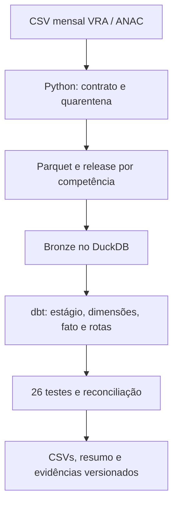

# Observatório da Qualidade do Transporte Aéreo

[](https://github.com/AlexandreSantosRodrigues/observatorio-qualidade-transporte-aereo/actions/workflows/qualidade.yml)

Pipeline de engenharia de dados e Analytics Engineering sobre os arquivos públicos mensais de **Voo Regular Ativo (VRA) da ANAC**. A pergunta é: como variam cancelamentos e chegadas com mais de 15 minutos de desvio por mês, empresa e rota, levando em conta apenas os voos elegíveis em cada denominador?

**Comece no navegador:** [abrir o notebook no Google Colab](https://colab.research.google.com/github/AlexandreSantosRodrigues/observatorio-qualidade-transporte-aereo/blob/main/notebooks/01_executar_no_colab.ipynb). Use CPU; a primeira execução usa janeiro de 2025 e DuckDB, sem GCP, cartão ou instalação local. O notebook permite selecionar os 12 meses. O Colab pode encerrar a sessão; exporte os resultados que queira conservar. O projeto não agenda recursos pagos.

## Evidência real, com limites explícitos

Na validação local dos **12 CSVs oficiais de 2025**, os arquivos foram baixados das URLs da ANAC, conferidos por SHA-256 e ingeridos como arquivos locais. Assim, os manifestos de execução dizem `arquivo_local`, enquanto [o registro anual](evidencias/2025/validacao_anual.json) associa os hashes às URLs de origem; não houve uma carga executada dentro do GCP.

| Verificação | Resultado |
|---|---:|
| Linhas da fonte | 1.005.807 |
| Etapas aceitas e modeladas | 1.004.900 |
| Linhas em quarentena | 905 |
| Cópias exatamente iguais removidas | 2 |
| Modelos / testes dbt aprovados | 7 / 26 |
| Chegadas elegíveis | 949.614 |
| Chegadas com desvio >15 min | 152.260 |
| Pontualidade de chegada nessa régua | 83,97% |

A identidade `fonte = aceitas + quarentena + duplicatas exatas` fecha em todos os meses. Os motivos de quarentena foram 334 exclusões de competência, 108 linhas com chave conflitante e 463 sem tipo de linha válido. `fora_competencia` é uma regra de recorte, **não** prova de erro da ANAC. Indicadores são descritivos e a régua de 15 minutos foi escolhida para este estudo. Uma nova revisão dos arquivos oficiais pode alterar esses números; hashes e contrato ficam no registro.

## O que o repositório executa



O reprocessamento troca o release de **uma competência inteira**. A chave de etapa separa identidade de conteúdo, preserva voos com número alfanumérico e envia duas versões conflitantes da mesma chave para quarentena. Os exports só recebem um novo ponteiro `CURRENT.json` depois do build e dos testes; arquivos anteriores permanecem acessíveis. Veja [arquitetura e contrato](docs/ARQUITETURA.md) e [definições dos indicadores](docs/INDICADORES.md).

O caminho opcional de [BigQuery Sandbox e IAM](docs/BIGQUERY_E_IAM.md) contém adapter, carga em lote e checagem bloqueante de faturamento. **Não foi executado em uma conta GCP**: a pessoa proprietária do projeto deve autenticar-se no Colab e confirmar quotas/permissões. O [guia de Power BI](docs/POWER_BI.md) traz modelo e medidas DAX; **não há relatório Power BI publicado nem arquivo `.pbix`**. GCS e Pub/Sub não são simulados ou alegados: exigem condições diferentes de conta/billing e ficaram fora deste percurso gratuito.

## Execute e investigue

No Colab, use **Ambiente de execução → Executar tudo** no [notebook](notebooks/01_executar_no_colab.ipynb). Comece com um mês, confira as linhas em quarentena e depois, se desejar, altere `COMPETENCIAS` para todo 2025. A etapa BigQuery começa desligada e é separada da análise principal. A célula final pode baixar um ZIP de resultados; o fato anual é grande.

Em qualquer ambiente remoto com Python 3.11+ e Git:

```bash
python -m pip install -e '.[dev]'
observatorio ingest --competencia 2025-01
python -m observatorio.workflow
pytest -q
```

O comando de ingestão baixa diretamente o arquivo oficial. `--arquivo caminho.csv` lê uma cópia local e registra essa origem como local. Consulte `data/releases/2025-01/<release>/manifesto.json` e `quarentena.json`; os arquivos atuais de análise são os da pasta indicada por `data/exports/CURRENT.json`. O arquivo `dbt/target/static_index.html` contém a documentação gerada. Dados, bancos, resultados e credenciais permanecem fora do Git. Para executar com BigQuery, siga o guia de Sandbox, em vez de pressupor que a conta é gratuita.

## Competências demonstradas

| Requisito da vaga | Evidência nesta versão |
|---|---|
| Python, SQL, modelagem relacional/dimensional, BigQuery SQL portátil | Ingestão, validação, 7 modelos dbt, dimensões, fato e agregado; BigQuery ainda não executado |
| Git, documentação, Data Quality e CI/CD | Histórico do repositório, contrato, 26 testes dbt, testes Python e GitHub Actions |
| Grandes volumes e análise | Mais de 1 milhão de linhas reais de 2025; Parquet, DuckDB e exportação em lotes |
| GCP, BigQuery e IAM | Código e guia de Sandbox/IAM; experiência real pendente de autenticação e execução |
| Power BI | Modelo e medidas preparados; dashboard real pendente de conta elegível |
| GCS, Pub/Sub, processamento em tempo real | Não cobertos neste projeto |

Os workflows de [qualidade](.github/workflows/qualidade.yml), [carga manual da ANAC](.github/workflows/carga-anac.yml) e [documentação opcional](.github/workflows/publicar-documentacao.yml) separam testes sintéticos de dados oficiais. A publicação de documentação por GitHub Pages é manual e usa **somente a fixture sintética**; exige habilitar Pages nas configurações do repositório. Nenhum workflow publica dados brutos nem armazena credenciais GCP. Consulte a fonte [VRA da ANAC](https://www.anac.gov.br/acesso-a-informacao/dados-abertos/areas-de-atuacao/voos-e-operacoes-aereas/voo-regular-ativo-vra/62-voo-regular-ativo-vra).
